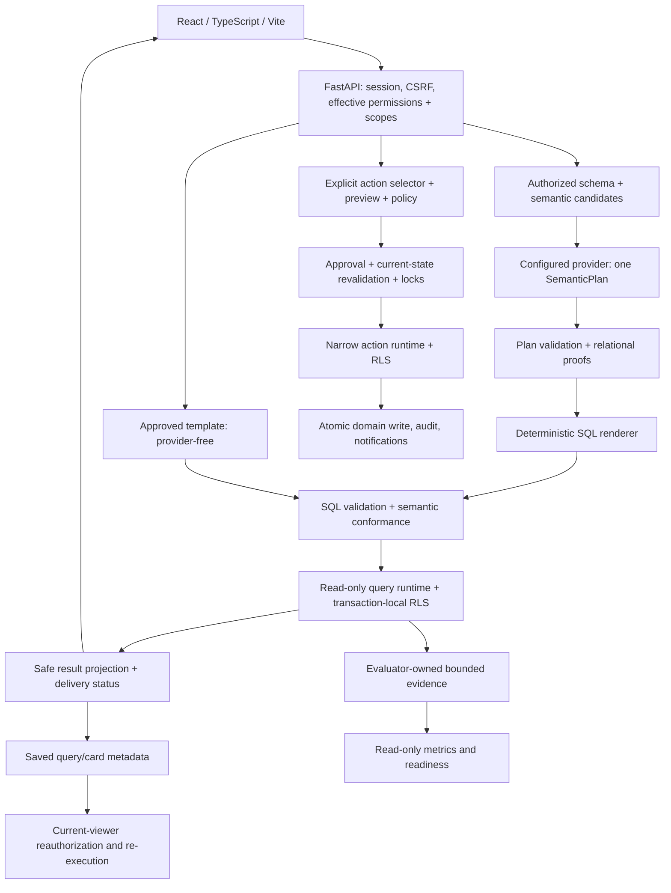

# QueryOps AI — ביקורת מצב ותוכנית השלמה

מועד הבדיקות: 26 באוקטובר 2026; סגירת הדוח: 27 באוקטובר 2026, Asia/Jerusalem. הבדיקה בוצעה בסיוע Codex, עם שלושה סוקרים עצמאיים לתחומי Query/Evaluation, Frontend, ו־Authorization/Actions. זהו דוח חקירה ותכנון; לא תוקנו קוד, בדיקות, הגדרות, prompts או migrations.

## א. הערכת מצב מנהלית

**QueryOps AI הוא אב־טיפוס מוצרי מתקדם עם תשתית ממשל ואבטחה רצינית, אך עדיין אינו מוצר אמין ומושלם לשימוש משותף אמיתי.** מרבית מסלולי המוצר קיימים ופועלים בסביבה סינתטית. החסם העיקרי אינו מחסור במסכים או צורך בשכתוב: הוא פער בין נכונות מקומית של רכיבים לבין נכונות הרשאות, מידע ותהליכים לאורך מסלול שלם.

ראיות חדשות מהגרסה הנוכחית:

- **1,779 בדיקות Backend עברו על PostgreSQL, ללא דילוגים**: 1,759 בסוויטה הכללית ועוד 20 בדיקות Action Security המחייבות לשחרור.
- **282 בדיקות Frontend עברו**, וכן lint, בדיקות טיפוסים ו־build. כל **12 בדיקות הדפדפן הכלליות ושתי בדיקות M8** עברו בסביבות מבודדות.
- למרות זאת שוחזרו עקיפת ביטול Scope ב־Dashboard, מרוצי Role requests, אובדן עריכת Dashboard, והצגה שגויה/חלקית של תוצאות. בנוסף, מסך Evaluation של Manager/Analyst נכשל מול PostgreSQL אמיתי.
- Canary אמיתי אחד, באמצעות **המודל המוגדר בפרויקט `gpt-5.6-luna`**, השלים 10 מקרים: **9 עברו; `medium-009` החזיר תשובה שגויה למרות ביצוע מוצלח**. אין להסיק מכך דיוק של 90% עבור שאלות משתמשים באופן כללי.
- `check_v1_readiness.py` החזיר כראוי **`incomplete`**. לא בוצעו שלוש הרצות יציבות ולא Full run אמיתי; אין ראיית שחרור חדשה.

**הכיוון הטכני נכון ברובו.** יש לשמור את המונולית המודולרי, Domain Pack, תוכנית `SemanticPlan`, SQL דטרמיניסטי, הרשאות Backend, RLS ושני runtime roles. אין ראיה המצדיקה מעבר ל־multi-agent runtime, SQL חופשי מהמודל, מנגנון repair, microservices או שכתוב Frontend. נדרשים תיקוני אמינות ממוקדים, יישור חוזים בין רכיבים, ושיפור ראיות האיכות.

המרחק להשלמה תלוי בהגדרת המוצר:

| יעד | מצב נוכחי | מה חסר |
| --- | --- | --- |
| דמו מקומי סינתטי של IT Operations | רוב המסלולים עובדים ומכוסים | תיקוני הרשאה/עקביות, תצוגת מידע, אמינות AI ו־QA מלא |
| Pilot משותף עם משתמשים אמיתיים | אינו מוכן | בנוסף: זהות אמיתית, הגדרות פריסה מאובטחות, תפעול ושחזור |
| פלטפורמה רב־דומיינית או multi-tenant | לא אומתה ולא נדרשת ל־V1 | אין הצדקה להרחיב לפני השלמת הדומיין הראשון |

אין בסיס אמין לאחוז השלמה או לתאריך סיום. היקף העבודה המומלץ הוא סדרת PRs ממוקדים; חיבור זהות אמיתית הוא החלטת היקף נפרדת, ולא פרט טכני קטן שניתן להסתיר בתוך hardening.

### מצב לפי מסלול מוצר

| מסלול | סיווג | הגבול של המסקנה |
| --- | --- | --- |
| Templates, governed SQL, query role/RLS | Verified Working בתרחישים שנבדקו | אינו proof לכל SQL אפשרי; full PostgreSQL suite עבר |
| Free questions | חלקית: Verified Working וגם Verified Defective | 9/10 Canary; omission עסקי מאומת; אין Full40 או יציבות |
| Ask→Card→refresh/export | חלקית | המסלול עובר, אך completeness disclosure והדמיה פגומים |
| Dashboard scope revocation ו־draft editing | Verified Defective | תרחישי F1 ו־F6 שוחזרו |
| שתי Actions, approval/audit/notifications | Verified Working בגבול ה־seed והבדיקות | 20 security + 2 browser gates; לא load/soak או recovery |
| Role upgrade תחת concurrency | Verified Defective | one-winner ו־one-pending אינם נשמרים |
| Evaluation UI scoped | Verified Defective | Manager/Analyst default reads נכשלו ב־PostgreSQL |
| Evaluator/readiness | מיושם ועובר tests; חסר evidence וחוזה identity | fail-closed נצפה; F4 מונע הסתמכות מלאה על matching |
| Shared deployment / real identity | Not Verified / לא ממומש במלואו | אין יעד production מוכח; demo-only |

## ב. גבולות הביקורת ושחזור ההיסטוריה

### הגרסה שנבדקה

ה־working tree היה נקי בתחילת החקירה. הבדיקה היא של `2d7796c` בענף `fix/m9-bounded-result-evaluation`, ולא של `main`: `main` המקומי וה־remote-tracking שלו מצביעים על `a64d1fa`. תיקון bounded-result כולל 54 קבצים שונים מ־main. אין לתאר אותו כממוזג על בסיס הבדיקה הזאת. קריאת metadata מ־GitHub אישרה את מיזוג PRs 57–60; לא נעשה fetch או שינוי בענפים, ולא נטענה הצלחת CI מרוחקת עבור הגרסה הנבדקת.

נוצר inventory של **470 קבצים tracked**, ובהם 123 קבצי `backend/app`, 80 קבצי בדיקות Backend, עשרה migrations, תשעה scripts, 203 קבצי `frontend/src`, שבעה קבצי E2E, תשתית ו־CI. בוצע מיפוי של כל התחומים ובדיקה מעמיקה של מסלולים קריטיים, לא קריאה שורה־שורה של כל 470 הקבצים. dependencies, קבצי build וקבצים בינאריים לא נחשבו מקור מימוש. מסמכי `docs/planning/` המקומיים שימשו לשחזור כוונה; לא שונו ולא נוספו ל־Git.

מקורות מרכזיים: [README](../../README.md), [PROJECT_PLAN](../../PROJECT_PLAN.md), [היסטוריית הפיתוח](../history/development-history.md), [Validation model](../development/validation-model.md), [Quality gates](../evaluation/v1-quality-gates.md), [Bounded-result contract](../evaluation/bounded-result-evidence.md), [Manual QA](../qa/v1-manual-qa.md), קוד נוכחי, Git history, ו־PR metadata. לא הועתקו לדוח חלקים נרחבים מהתכנון הפרטי.

### מה השתנה לאורך הדרך

| שלב | כוונה והישג היסטורי | משמעות כיום |
| --- | --- | --- |
| M0–M3 | בסיס מונורפו, מודלים ו־seed, demo auth, permissions/scopes ו־RLS | קיים ונבדק; זהות אמיתית לא הושלמה |
| M4–M7 | Query Engine, Ask Data, Cards/Dashboards/CSV, עיצוב וניווט | מסלולים עובדים; נמצאו פערים בחיבור תוצאות, תצוגות והרשאות |
| M8 | שתי פעולות דטרמיניסטיות, approval, audit, notifications | מסלול Manager→Analyst→execution עבר; Role requests הישן לא קיבל אותה רמת הגנה מתחרות |
| M9, PRs 36–46 | Evaluation, ספק אמיתי, readiness, semantic catalog, plan-only ו־V2 | תשתית עשירה; השלמת מימוש אינה הוכחת איכות AI |
| PRs 50–56 | OR composition, structural diagnostics, הוכחות יחסיות ושלמות candidate paths | פתרו בעיות מבנה והקשר; אינם מבטיחים פירוש נכון של השאלה |
| [PR57](https://github.com/Daniel23sh/queryops-ai/pull/57) | העברת בעלות על פירוש השפה ל־planner | lexical matches הם candidates/guidance; אינם מחייבים בחירה. אין כיום מקור production עצמאי ל־Required Intent |
| [PR58](https://github.com/Daniel23sh/queryops-ai/pull/58) | תיקון חוזי זהות/קיבוץ/דירוג ב־Evaluation V2 | פערי evaluator אינם בהכרח כשל runtime; ראיות ישנות אינן כשירות |
| [PR59](https://github.com/Daniel23sh/queryops-ai/pull/59), [PR60](https://github.com/Daniel23sh/queryops-ai/pull/60) | output contract של הספק ונרמול PostgreSQL version | שינויים נקודתיים שמוזגו; אינם פותרים אמינות סמנטית |
| `2d7796c` | הבחנה בין מסירה מוגבלת לבין נכונות אוכלוסיית התשובה, עם evidence מוגבל משאבים | עובד במסלול ההערכה שנבדק; propagation ל־Dashboard/CSV עדיין חסר |

Self-correction, provider-generated SQL וסטטוסים ישנים במסמכי התכנון הם כוונה היסטורית שבוטלה במפורש. לעומת זאת demo-only auth עדיין מגביל את המוצר בפועל. אין לסמן כל פיצ'ר היסטורי כחסר שיש לבנות; יש לבחור scope נוכחי ולתעד את ההחלטה.

## ג. הארכיטקטורה והמסלולים בפועל



**Ask Data:** המשתמש מזוהה דרך session חתום; הרשאות ו־Scopes נפתרים מחדש. Templates אינם קוראים לספק. בשאלה חופשית נבנה context מאושר, והספק מפיק תוכנית בלבד. לאחר validation/rendering/conformance מתבצע SQL מאושר תחת `queryops_query_runtime`, transaction read-only, RLS ו־timeouts. SQL נחשף רק לפי permission. השכבות מאמתות את התוכנית ואת הביצוע; הן אינן oracle עצמאי לכוונת השפה. זה מסביר כיצד `medium-009` יכול לעבור אותן ולהחזיר תשובה לא נכונה.

**Dashboards ו־CSV:** נשמרים reference/query/config/layout ולא snapshots של rows. Refresh/export מבצעים authorization מחדש עבור הצופה, validation והרצה מחודשת; זהו עיקרון חשוב. שני פערים חוצים כאן רכיבים: dashboard metadata נשען בחלק מהנתיבים על department affiliation במקום Scope מפורש, ו־delivery completeness אינו נשמר עד התצוגה/הייצוא.

**Actions:** רק `reclaim_unused_license` ו־`disable_inactive_user`. Targets מפורשים ומוגבלים; אין בחירת targets או SQL mutation מהמודל. Preview, בדיקת מדיניות, אישור, נעילות/revalidation, runtime role ייעודי ו־audit/notifications אטומיים. פעולות סינכרוניות ו־notifications במסד הן בחירות סבירות ל־V1 מוגבל; אין ראיית עומס שמצדיקה queue.

**Role requests:** workflow נפרד וישן יותר; הוא מעדכן role/scope ואירועי audit אבל חסר בו terminal-state claim אטומי. אין להשליך מהצלחת בדיקות Action Engine על נכונותו.

**Evaluation:** CLI בלבד מפעיל הערכה; המסך קורא projections מאומתים. V2 מכיל 40 מקרים ו־Canary קבוע של עשרה. נשמרת הבחנה בין expected behavior, semantic contract, result comparison, delivery ו־failure stage. תיקון bounded-result מוסיף snapshot משותף וראיות מוגבלות משאבים. `ready` דורש שלושה Canary תואמים, Full run כשיר ושערים דטרמיניסטיים; Manual QA הוא תנאי נוסף לשחרור. קיים פער בזיהוי תצורת הספק, המתואר בהמשך.

**תשתית:** Docker Compose הוא stack פיתוח: PostgreSQL 16, backend reload, Vite dev server, bind mounts וברירות מחדל מקומיות. Backend dependencies מוגדרים בטווחי גרסאות ולא ב־lock מלא. `/health` בודק liveness בלבד. אין בפרויקט הוכחה לפריסת production, שחזור מגיבוי, ניטור, capacity או identity provider עובד.

## ד. תוצאות אימות חדש

כל DB שמשתנה הוקם במיוחד לביקורת עם נתונים סינתטיים. PostgreSQL 16.14 הופעל בארבעה containers נפרדים. ההפרדה נחוצה משום שה־runtime roles הם cluster-global וה־migrations מסרבים בצדק לשנות role קיים. לא בוצעו reset, migration או seed למסד המשתמש.

| בדיקה | תוצאה | פרשנות |
| --- | --- | --- |
| Ruff `check app scripts`, Pyright, compileall | עברו; Pyright ללא errors/warnings | Pyright מכסה include set מוגדר, לא את כל ה־Backend |
| pytest ללא PostgreSQL | 1,580 עברו, 199 דולגו | ראיה חלקית בלבד; הושלמה בהרצה הבאה |
| PostgreSQL `test_action_security_release.py` | 20 עברו, 0 skips | exact release suite |
| PostgreSQL suite ללא הקובץ הנפרד | 1,759 עברו, 0 skips | roles/RLS/locking/integration לפי הכיסוי הקיים |
| Alembic upgrade/current/check במסד חדש | head `0010_disable_inactive_user`; ללא model diff | לא בוצע downgrade/upgrade round-trip חדש |
| Frontend lint, app/node types, Vitest, build | 282 tests ב־48 קבצים; עברו | אזהרת chunk charts בגודל כ־566KB; אינה חסם build |
| General Chromium E2E על seed טרי | 12/12 עברו | חלק מבדיקות Evaluation משתמשות ב־API mocks; אין לייחס להן integration אמיתי |
| M8 Chromium E2E נפרד | 2/2 עברו | אישור וביצוע פעם אחת ב־Scope מתאים; User נדחה עם CSRF תקין וללא persistence |
| Scoped Evaluation על PostgreSQL אמיתי | Manager/Analyst: שגיאת SQLSTATE42883 ו־API503; Admin: תגובה רגילה | תקלה מאומתת F13, למרות הצלחת ה־E2E עם fixtures |
| UI smoke נוסף | Chromium 149.0.7827.55; desktop 1440×1000, mobile 375×812; light/dark | ללא page errors או horizontal overflow במדגם routes; אינו תחליף ל־QA מלא או screen reader |
| שלוש בדיקות Frontend זמניות עצמאיות | שלושת השחזורים הצליחו | assert על ההתנהגות הפגומה, לא בדיקות תיקון |
| PostgreSQL probes עצמאיים | Scope bypass, שתי החלטות סותרות, שתי בקשות pending | כל אחד שוחזר מול routes ו־DB אמיתיים |
| Query/Evaluation focused tests | 262 עברו | בנוסף, לא במקום full suite |
| Offline semantic-ownership audit | 20 accept/accept; 15 reject/accept; 4 reject/reject | diagnostic של שינוי בעלות, לא score איכות אנגלית |
| Mock V2 full | 40 הושלמו; 11 עברו; 29 clarification במקום success | Mock מצומצם ואינו מדמה איכות planner; אין להסיק 27.5% דיוק של המודל האמיתי |
| Live V2 Canary | 10 הושלמו; 9 עברו | כשל אמיתי אחד; ללא full run או stability qualification |
| Readiness CLI | exit 2, `incomplete`, `stability_runs_missing` | fail-closed תקין; הרצה אחת אינה שחרור |

### תיעוד הרצת ה־AI

- Source: `2d7796c`; provider `openai`; model **`gpt-5.6-luna`**, כפי שהוגדר ב־`.env` הקיים. README ו־defaults מציגים `gpt-5.6-terra`; לא הוחלף המודל ב־Codex/Astra.
- `reasoning_effort=low`, `max_output_tokens=2048`, `timeout_seconds=45`, `max_retries=2`.
- seed `medium`, seed number 42, reference `2026-10-26T12:42:21Z` — 14:42:21 ב־Asia/Jerusalem.
- dataset `it_operations_v2` v2, digest `6ac164ab6c58c0b008a65afc01cd26aa434fecd3eaa402b5bdad9c89e6f6540f`.
- Canary v1, digest `83dadd97b819003e9e6aa20b4487affc8a3c926cd7ca3d2672c85225b4ae3fc2`.
- catalog v3, hash `918df0c63288b7ed7ce700f8442c82bc1ffa3f51e1f4eaa63fd66012af82adb4`.
- run ID `879863e8-1d58-406b-9b0e-9d4c33dda4af`; environment fingerprint `252c567f3898191a4956e4b08774b3f0925bda28a925efdedffd0269a5c67d2c`.
- 9 calls ו־9 attempts **לפי telemetry הקיים**, 50,892 input tokens, מתוכם 16,736 cached; 2,004 output; סה״כ 52,896. ממצא F10 מגביל את אמינות ספירת attempts. לא זמין כאן חיוב כספי מאומת; אין להמציא מחיר בדולרים.
- 7 query executions מוצלחים, 7 plans generated/validated, אפס renderer/conformance defects שנמדדו, security-case pass rate 1.0 במדגם, semantic-contract pass rate 6/7. Overall semantic score 0.975 לעומת 9/10 case pass: מדדים אלה אינם שקולים.
- לא נשמרו בדוח rows, prompts, SQL, payloads או credentials. לא נעשתה התאמת prompt/dataset לפי תוצאות. הוחלט לא להרחיב הוצאה על רצף qualifying לפני תיקון חסמי האמינות וזהות התצורה; זו בחירת חקירה, לא חסימת credentials.

### כשלים של סביבת הבדיקה שהופרדו מתקלות מוצר

ניסיון ראשון ב־M8 נדחה כי `DATABASE_URL` ו־test URL היו זהים; guard תקין. הרצה חוזרת עם כתובות שונות עברה. הקמת כמה databases באותו cluster נתקלה ב־role קיים; הוקמו clusters נפרדים ללא החלשת migration. בדיקות דפדפן ראשונות ערבבו `localhost` עם `127.0.0.1`, ו־helper קיבל 401; תיקון env בלבד פתר זאת. ריצה חוזרת על seed שכבר צבר exports נכשלה ב־assert שמצפה לאירוע אחד בדיוק; ריצה על seed טרי עברה. מכאן נובע שהפקודות אינן repeatable באופן מלא ללא orchestration, לא ש־CSV export שבור.

מגבלת שימוש זמנית הפסיקה agents ובדיקת אישור אוטומטית בחלק מהחקירה. לאחר המשך, הבדיקות המרכזיות הושלמו; אין לייחס לה תוצאת אבטחה או כשל מוצר.

## ה. ממצאים לפי עדיפות

סיווגים: **Verified Working** — נבדק בגבול המצוין; **Verified Defective** — תרחיש שגוי שוחזר; **Likely Issue** — ראיות סטטיות/חלקיות; **Not Verified** — אין ראיה מספקת; **Blocked** — בדיקה נעצרה בגלל תנאי חסר. P1 חוסם אמינות/שחרור בסקופ הרלוונטי; P2 תיקון חשוב; P3 שיפור אופציונלי. לא נמצא בסיס לטעון לפרצת P0 בלתי־מאומתת.

### F1 — ביטול Scope אינו מבטל גישה ל־Dashboard מחלקתי

**Verified Defective · High · P1 · ביטחון גבוה.** Analyst ללא אף `UserAccessScope`, אך עם `AppUser.department_id` הישן, קיבל GET 200 ל־Dashboard של משתמש אחר באותה מחלקה, `can_manage=true`, ו־PATCH 200 ששמר שינוי כותרת.

הסיבה: `backend/app/dashboards/policy.py:23–24` מתיר affiliation equality; `dashboard_is_manageable` יורש זאת. אותו fallback מופיע ב־`backend/app/api/routes/dashboards.py:1042–1053`. זה מנוגד לעקרון exact assigned scopes. ההשפעה המאומתת היא metadata ועריכה בלתי מורשית; **לא הוכחה עקיפה של RLS או זליגת business rows**. Refresh/export חייבים להמשיך להיבדק בנפרד.

כיוון תיקון: להסיר authorization מ־department affiliation בשני המסלולים, ולהשתמש במדיניות המבוססת על assignments ו־effective permissions. לבדוק catalog/library/detail/source/create/save/duplicate/update/archive/card operations אחרי revocation, לצד positive cases של Scope שני מפורש ו־global מפורש. זהו התיקון הראשון המומלץ.

### F2 — Role requests אינם אטומיים תחת תחרות

**Verified Defective · High · P1 · ביטחון גבוה.** בשני sessions של PostgreSQL: approve ו־reject לאותה בקשה החזירו שניהם 200; המצב הסופי היה `rejected` אך המשתמש קיבל `manager`, ונשמרו שני audit events של הצלחה. בניסוי נוסף שני create מקבילים החזירו 201 ויצרו שתי בקשות pending.

מקורות: `backend/app/api/routes/role_requests.py`, הסמלים `_get_role_request_or_error`, `_role_request_processing_error`, `approve_role_request`, `reject_role_request`, ו־create בשורות 104–145; `backend/app/models/product.py:441–452`. זהו check-then-write ללא lock/CAS ואילוץ uniqueness מתאים. הבדיקות הקיימות ל־Role requests הן ברובן SQLite וסדרתיות; Action Engine החדש דווקא כולל מנגנוני claim/locks.

כיוון תיקון: החלטה אחת מנצחת, transition מותנה ב־pending, revalidation של מצב המשתמש וה־Scope, ואטומיות role/scope/request/audit. להבטיח בקשה pending אחת באמצעות DB invariant או serialization על requester. נדרשות בדיקות PostgreSQL מאולצות ל־approve/approve, approve/reject ו־create/create. אין כאן הוכחה של אישור בידי גורם בלתי מורשה; הבעיה היא סתירה בין החלטה, הרשאה ותיעוד.

### F3 — תוצאת AI לא נכונה מוצגת כהצלחה טכנית

**Verified Defective במקרה שנמדד · High product impact · P1 · ביטחון גבוה במקרה, לא בשיעור שכיחות.** ב־`itops-medium-009` התקבלו 11 תוצאות מול 16 נדרשות. שני הצדדים complete/exhausted; `required_rule_missing`, `rules_correct=false`. Plan validation, rendering ו־conformance עברו. זוהי השמטת בחירה של כלל semantic composition, לא כשל bounded-result ולא הוכחה לכשל DISTINCT בהרצה הזאת.

מקורות: ההרצה המתועדת לעיל; `backend/app/query_engine/semantic_grounding.py`, `plan_generator.py`, `semantic_plan.py`; case `itops-medium-009` ב־`backend/app/domains/it_operations/domain_pack/evaluation_questions_v2.yaml`; `scoring.py` ו־runner. התיקון ההיסטורי של OR לא סיים את בעיית פירוש השפה.

כיוון תיקון: חבילת diagnosis ממוקדת של semantic selection/composition על families של שאלות ו־held-out paraphrases, תוך שמירת ה־dataset והספים. לא hard-code של case ID או question ולא החזרת lexical grounding כבעל סמכות על השפה. יש להשוות שיפור context/prompt/contract מול שינוי מודל רק בניסוי מבוקר ומתועד. אין הצדקה עדיין ל־repair agent.

### F4 — Canary/full identity אינה מקפיאה את כל תצורת הספק

**Verified Defective בחוזה זהות · High evidence impact · P1 לפני qualifying evaluation · ביטחון גבוה.** `low/2048` ו־`high/4096` של אותו model מפיקים אותו `ProviderDescriptor`. `EvaluationEnvironmentIdentity` אינו כולל reasoning effort, output cap, timeout או retries, וה־stability/readiness משווים את הזהות החסרה. לכן ההשוואה אינה יכולה להבחין בתצורות שונות, בניגוד למדיניות שמחייבת invalidation על שינוי התנהגות.

מקורות: `backend/app/query_engine/provider_config.py` — `ProviderDescriptor`; `backend/app/evaluation/environment.py:74–99`, `_dependency_manifest_hash`; `runner.py`, `stability.py`, `readiness.py`. גרסאות packages נבדקות ב־manifest החיצוני אך אינן כולן חלק מהזהות persisted; hash של `pyproject.toml` עם טווחי גרסאות אינו fingerprint של כל ההתקנות בפועל. לא בוצעה יצירת release מזויף כדי להוכיח זאת; השחזור והמעקב מראים collision בזהות עצמה.

כיוון תיקון: versioned, sanitized runtime/provider configuration digest ללא secrets, הכולל dependency versions המשפיעות על ההתנהגות; להשתמש בו באותה צורה ב־manifest, persistence ו־matching. Evidence ישן שאינו מכיל את החוזה החדש יהיה incomplete, לא יקבל defaults שמכשירים אותו. לבצע זאת לפני הוצאה על שלוש הרצות qualifying.

### F5 — אזהרת תוצאה מוגבלת אובדת ב־Cards וב־CSV

**Verified Defective בחוזה API עם executor מבוקר · Medium/High · P1 לשלמות תשובות · ביטחון גבוה.** `SQLExecutionResult` עם 100 rows, `truncated=false`, ו־`delivery_completeness=safety_limited` עובר דרך refresh ל־response ללא delivery status, ללא warning; CSV מכיל 100 rows ללא אינדיקציית completeness. SQL שנשמר עם safety-added `LIMIT 100` מאומת מחדש כ־`limit_source=input`, ולכן המקור של המגבלה אובד.

מקורות: `backend/app/query_engine/card_refresh.py:126–160`; `backend/app/api/routes/exports.py:250–303`; validation של saved executed SQL. השחזור משתמש ב־API fixtures וב־executor stub כדי לבודד propagation, **לא מוכיח שנשלפו 101 rows ממסד באותו ניסוי**. Ask Data עצמו כן מעביר ומציג Partial; החשד לכשל בו נשלל בקריאת המסלול הנוכחי.

כיוון תיקון: לשמר provenance של answer bound ו־delivery לאורך query→card→refresh→export, להבחין business top-N מ־safety cap, ולהציג אזהרה/בחירה ברורה גם בייצוא. לא להסיר cap, להחליש RLS או לשמור rows כדי להסתיר את הבעיה. להוסיף PostgreSQL fixture עם אוכלוסייה מעל cap ובדיקת browser/CSV מלאה.

### F6 — שינוי Card מוחק layout draft שלא נשמר

**Verified Defective · Medium · P2 · ביטחון גבוה.** resize לא נשמר, אחריו Rename Card: לאחר reload כפתור Save changes נעשה disabled ונכתב שאין שינויים, ללא אישור discard.

מקור: `frontend/src/features/dashboard/DashboardDetailPage.tsx:80–90` וה־reload callbacks סביב 284–291. האפקט מאתחל draft עם כל detail חדש. בדיקה עצמאית מרנדרת את האפליקציה עם API mock ומוכיחה את רצף הפעולות. כיוון תיקון: להפריד refresh metadata מהחלפת draft, או להציע save/discard לפני פעולה מתנגשת; לשמר conflict detection. נדרשות בדיקות compositional של resize/move יחד עם rename/add/remove/visualization, לא רק כל פעולה בנפרד.

### F7 — המלצת KPI על `total_licenses` מציגה `—` במקום 42

**Verified Defective · Medium · P2 · ביטחון גבוה.** `inferVisualization` מזהה single numeric row כ־KPI, אבל `mappingForType` מסנן עמודות עם שמות target/total/max/limit/capacity מהערכים גם כאשר אינן denominator של gauge. `total_licenses:42` מקבל `value_columns=[]`.

מקורות: `frontend/src/features/dashboard/visualization/inferVisualization.ts` — `mappingForType`; `DashboardVisualization.tsx:114–120`. כיוון תיקון: הבחנת target לפי סוג visualization ורק כאשר קיימת זוגיות value/target אמיתית; להבטיח primary numeric fallback. לבדוק KPI ו־charts עם aliases עסקיים נפוצים, ולא רק `count`.

### F8 — Table Card מסתיר rows 11–24 ללא אזהרה

**Verified Defective · Medium · P2 · ביטחון גבוה.** ב־11 rows, `TableVisualization` מציג רק עשרה אך warning מחושב לפי cap של 24. ה־row count מתאר את כל התוצאה, ואין גישה לשורה ה־11 בכרטיס.

מקור: `frontend/src/features/dashboard/visualization/DashboardVisualization.tsx:24,51–75,125` ו־`rows.slice(0,10)` בהמשך. כיוון תיקון: לחשב visible subset לפי renderer בפועל, ולהציע table expansion/pagination או מספר גלוי של shown/total. אין צורך במערכת grid חדשה. לשלב עם F5 את שפת ההסבר, אך להבחין UI clipping מ־SQL delivery cap.

### F9 — `AUTH_MODE` אינו מכבה Demo login

**Verified Defective כהגדרת תצורה · High אם נחשף לשימוש משותף · P1 לפני Pilot; גבול ידוע לדמו.** תהליך עם `AUTH_MODE=disabled` עדיין מאפשר demo admin login ומחזיר 200. `disabled` אינו mode נתמך מתועד; הניסוי מוכיח שהמשתנה אינו guard, ולא ש־production auth מתועד התקלקל.

מקורות: `backend/app/api/routes/auth.py:37–44` יוצר `DemoAuthProvider` ישירות; `core/config.py:26–35`; `auth/providers.py` מכיל stub שאינו זמין לספק נוסף. שינוי secret בלבד אינו הופך זאת למערכת זהות אמיתית. README מציין בצדק demo-only.

כיוון תיקון: עבור V1 מקומי — reject mode לא נתמך וגבול demo מפורש. עבור Pilot — החלטת identity provider ומימוש מלא נפרד, token validation, mapping מפורש ל־AppUser, session/security configuration. אין לבחור Supabase רק משום ששם המחלקה קיים. אין צורך ב־SSO ארגוני מלא אם scope נשאר demo סינתטי.

### F10 — telemetry ממעיט בספירת retries

**Verified Defective · Medium · P2 · ביטחון גבוה.** SDK הוגדר `max_retries=2`; transport זמני שהחזיר HTTP 500 ואז הצלחה ביצע שתי בקשות, אך measurement דיווח `attempt_count=1`.

מקורות: `backend/app/query_engine/openai_provider.py:198–208,452–467`. בנוסף, failure paths לפני יצירת metadata אינם מספקים תמונה מלאה של usage. אין טענה כי ההרצה החיה הזאת אכן ניסתה retry; ספירת 9 attempts היא דיווח האפליקציה בלבד.

כיוון תיקון: instrument attempts בפועל או להפריד במפורש logical calls מ־unknown transport attempts; לשמר usage זמין גם בכשל באופן מסונן. בדיקות transport ללא רשת מספיקות לרוב התיקון. אין להוסיף מחירון משתנה לקוד המוצר.

### F11 — התאמה חלקית בין evaluator לבין האלגברה הנתמכת

**Verified restriction / Likely product friction · Medium · P2 · ביטחון גבוה בהגבלה, בינוני בהשפעה.** Runtime דורש ב־aggregate plan ש־`output_fields` ו־`group_by` יהיו קבוצות זהות (`semantic_plan.py:435–438`), בעוד evaluator מכיר שקילויות המבוססות על unique/FK identity. תוכנית SQL תקפה עם grouping נוסף שאינו projected נדחית; לעומת זאת צורה קנונית של `hard-004` כן ניתנת לייצוג ועברה probe offline.

אין לטעון ש־hard-004 שבור תמיד או שכשל ה־Canary הנוכחי נגרם ממנו. כיוון תיקון: להחליט מהו supported algebra מינימלי, ליישר prompt/schema/runtime/evaluator ולבדוק legal-equivalence cases. אפשר להעדיף canonicalization מוגבל במקום הרחבה כללית של SQL; יש לשמר הוכחות זהות ו־fanout. אין לשנות baseline כדי להכשיר תשובה שגויה.

### F12 — תיעוד ומדדי הצלחה עלולים להטעות

**Verified inconsistency · Low/Medium · P2.** README מתאר Required Intent דטרמיניסטי מחייב גם בתרשים השאלות החופשיות; PR57 והקוד הנוכחי הפכו NL hints ל־non-binding. `v1-readiness-report.md` משמר במפורש checkpoint ישן ומדיניות v1, בעוד Quality Gates הנוכחי הוא v2. `validation-model.md` מציין שאין single local command למרות קיום `scripts/check`; נכון עדיין שאין command שמכסה את כל graph של CI והבידוד.

כיוון תיקון: לאחר החלטות ההשלמה, לעדכן רק current contracts ולהפריד קישורים להיסטוריה; לא לשכתב את התכנון הפרטי. UI/דוח צריכים להפריד executed, semantically correct, fully delivered ו־release-ready. בניסוי supplied-plan, DISTINCT חסר יכול לקבל semantic-contract subscore חיובי, אך final result comparison הנוכחי דוחה אותו אפילו כשה־rows ריקים. אין כאן false-positive מוכח של verdict הכולל; יש פער במדד המשנה. מדדי 0.975 semantic score ו־100% expected-behavior בהרצה החיה לא ביטלו את התשובה השגויה.

### F13 — מסך Evaluation של משתמש scoped נכשל ב־PostgreSQL

**Verified Defective · High functional impact · P1 · ביטחון גבוה.** Manager ו־Analyst מקבלים 503 ב־default Evaluation overview, גם במסד seeded ללא runs. Readiness מחזיר 200 עם incomplete; זהו endpoint נפרד. בדיקה ישירה מצאה SQLSTATE `42883`: PostgreSQL אינו יכול לבצע equality על טיפוס JSON. נשלל חוסר ב־evaluation actor או ב־Scope: הזהויות וההקצאות תקינות. Admin/global אינו נכנס לענף הפגום.

הסיבה: `backend/app/evaluation/read_service.py:367–395`, `_load_snapshot`, מבצע JOIN ל־EvaluationResult ואז `.distinct()` על כל `EvaluationRun`, כולל `summary` מסוג JSON. הבעיה היא בצורת השאילתה, ולא בתוכן run מסוים. API tests המבוססים על SQLite ו־Evaluation E2E המחזירים fixtures אינם מגלים אותה. השגיאה הפנימית מוסתרת מהלקוח כראוי; אין כאן ממצא disclosure.

כיוון תיקון: correlated `EXISTS` ל־visible results, או בחירת IDs ייחודיים ואז טעינת entity, תוך שמירת visibility/order/limit. אין צורך ב־JSONB migration או בהרחבת הרשאות. להוסיף PostgreSQL API regression ל־Manager/Analyst עם מצב ריק, run נגיש ו־run לא נגיש; Admin כ־control. לאמת גם sibling routes המשתמשים באותו loader ו־browser אמיתי ללא route mocks. שחזור: `/tmp/queryops-evaluation-read-probe.py`, ראיות ב־`/tmp/queryops-evaluation-read-probe.log`.

### F14 — Candidate recall מגביל שאלות תקינות עוד לפני המודל

**Verified candidate behavior; Not Verified בהרצה חיה של שאלות אלה · Medium · P2 · ביטחון גבוה בהגבלת context.** בפרויקט schema מאושר, השאלות “How many computers do we manage?” ו־“Count all company laptops.” מפיקות אפס entity candidates; “List all endpoints.” כן משמרת devices. המודל חייב לבחור מתוך projected candidates, ולכן עצם הימצאות devices ב־schema אינה מספיקה לתוכנית תקפה.

מקורות: `backend/app/query_engine/semantic_grounding.py:151–238,447–464`, `semantic_plan.py:264`, ו־natural_language_references ב־semantic catalog; `/tmp/queryops-candidate-probe.py`. ההשפעה האפשרית היא clarification/rejection לשאלות עסקיות רגילות. לא נטען ש־provider חי נכשל בכל אחת מהן, ולא נמדד recall באוכלוסייה מייצגת.

כיוון תיקון: להוסיף corpus עצמאי של vocabulary/paraphrases ולמדוד candidate recall בנפרד מאיכות המודל. לשפר domain synonyms או fallback מאושר ומוגבל לפי תוצאות רוחביות; לא להוסיף embeddings או להסיר authorization ללא צורך מוכח. לשלב ב־W6.

### F15 — ענף Dashboard ישן ובלתי נגיש נשאר במאגר

**Verified implementation debt · Low · P3 · ביטחון גבוה.** מיפוי imports מ־`main.tsx` וחיפוש references בכל ה־tree מצאו 14 production files, כ־1,246 שורות, המשמשים רק זה את זה או בדיקות ישנות. אלה כוללים `DashboardPage.tsx`, רכיבי DashboardCardGrid/OrderControls/Preview, CatalogGrid/Item/Page, ViewGrid, MyDashboardsPanel, SortableDashboardCard, CreateDashboardPanel ושלושת hooks: useDashboardCardOrder/useDashboardCatalog/useMyDashboards. כולם תחת `frontend/src/features/dashboard/`.

שלוש תלויות `@dnd-kit/core`, `@dnd-kit/sortable`, `@dnd-kit/utilities` משמשות בקוד production רק בענף הישן; העורך הפעיל משתמש ב־react-grid-layout. אין מכאן טענה שכל הקוד נכלל ב־bundle — הבעיה היא עלות תחזוקה ובדיקות למסלול שאינו נגיש.

כיוון תיקון: PR deletion לאחר העברת regression coverage רלוונטי לעורך הפעיל; לוודא שוב consumers לפני הסרת dependencies. API helpers ו־types משותפים אינם מועמדים למחיקה גורפת. זהו W10 אופציונלי, ולא סיבה לעכב תיקוני הרשאה או לבנות design system מחדש.

## ו. מה לשמר, לפשט ולדחות

### לשמר

- Backend authorization, explicit scopes, RLS ושני runtime roles נפרדים; לא לקצר בדיקות trust boundary בשם פישוט.
- Single-call plan-only, SQL rendering דטרמיניסטי, SQLGlot validation/conformance, limits/timeouts.
- Current-viewer refresh/export, CSV formula protection ו־audit; explicit targets ו־revalidation בפעולות.
- distinction בין AppUser ל־DirectoryUser; seed דטרמיניסטי סינתטי.
- fail-closed readiness, immutable historical V1 ו־V2 contracts; bounded evidence במקום מתן קרדיט ל־100 rows ראשונים בלבד.

### לפשט באופן ממוקד

- מקור אמת אחד להחלטת scope של Dashboard במקום שני fallbacks סותרים; להשתמש בתשתיות הקיימות.
- ליישם ב־Role requests את invariant של one terminal decision, בלי להפוך את כל התהליכים ל־generic workflow framework.
- להשאיר diagnostics היסטוריים מחוץ למסלול production ולציין את גרסתם; לא להפוך legacy intent parser שוב לבעל סמכות סמויה.
- קבצים גדולים כגון `dashboards.py`, `semantic_grounding.py`, `runner.py`, `scoring.py` מרכזים חוזים רבים. לפצל לפי אחריות רק במסגרת תיקון שמבהיר boundary; line count לבדו אינו ממצא.
- רכיבי dashboard ישנים שאינם ב־route graph הם מועמדי ניקוי לאחר הוכחת אי־שימוש ובדיקת imports/tests. לא נדרשת מחיקה לפני תיקוני P1.

### חלופות עם tradeoffs

| החלטה | המלצה | חלופה והמחיר |
| --- | --- | --- |
| NL semantics | planner מפרש; catalog/relational proofs/safety אוכפים חוזים | parser דטרמיניסטי שני עשוי לדחות כוונה תקפה ומחזיר כפילות שכבר הוסרה |
| תיקון דיוק | diagnosis משפחות סמנטיות + ניסוי מבוקר | החלפת מודל אולי משפרת איכות אך משנה עלות/latency ואינה מתקנת חוזי UI/authorization |
| async Actions | להשאיר synchronous ב־V1 מוגבל | queue מחייב recovery/idempotency/monitoring נוספים; לא מוצדק ללא מדידה |
| תצוגת תוצאה חלקית | metadata אמין והסבר ברור לאורך כל המסלול | הסרת cap מגדילה סיכון משאבים ואינה פותרת provenance |
| שחרור ראשון | local synthetic V1 מפורש אם זה היעד המוסכם | Pilot אמיתי דורש חבילת identity/deployment נפרדת ומשמעותית |

**לדחות:** דומיין שני, NoSQL adapters, multi-tenancy, פעולות נוספות, email/Slack, scheduler, agent repair ו־microservices. רובם היו מחוץ ל־V1 המקורי ממילא. שיפור chunk size ועומס רשימות חשובים רק לאחר מדידת בעיה אמיתית. אין ראיית latency/load מספקת להכריז כיום על כשל ביצועים.

## ז. Roadmap מעשי לפי תלות

הגודל יחסי: S — תיקון מקומי עם בדיקות; M — כמה שכבות וחוזים; L — שינוי trust/deployment משמעותי. זו אינה התחייבות לזמן קלנדרי. כל חבילה היא scope אפשרי ל־PR; אין כאן אישור לבצע אותה במסגרת החקירה.

| חבילה | מטרה והיקף | תלות | תוצאת קבלה נצפית | אימות | גודל / סיכון |
| --- | --- | --- | --- | --- | --- |
| W1 — Dashboard scope authority | תיקון F1 ב־policy ובכל callers, capabilities ו־create/save | אין | Revocation מונע כל גישה/שינוי מחלקתי; assigned secondary/global עדיין עובדים | API + PostgreSQL matrix + browser; review עצמאי | M, V3; שינוי הרשאה מכוון |
| W2 — Atomic Role requests | תיקון F2, pending invariant, current-state validation, audit אטומי | החלטה lock/CAS ו־DB invariant | one winner; loser conflict; request/role/scope/audit מסכימים | PostgreSQL two-session races; migration אם נדרש; UI conflict | M, V3; persistent permissions |
| W2a — Scoped Evaluation reads | תיקון F13 ב־latest-run loader, ללא שינוי schema או visibility | אין; יכול להתבצע אחרי W1 במקביל ל־W2 | Manager/Analyst מקבלים empty/visible projection תקין ולא 503; inaccessible runs נשארים מוסתרים | PostgreSQL API + browser ללא mocks + Admin control | S, V2; לשמר nondisclosure |
| W3 — Reliable result delivery | F5 ו־F8: provenance ו־completeness ב־saved source/refresh/CSV/UI; הבחנת visual subset | contract קצר לפני קוד | מעל cap תמיד warning; explicit top-N לא מסומן בטעות; אין silent row loss | PostgreSQL מעל cap, API/CSV/browser, no-row-persistence assertions | M, V3; public/persisted contract |
| W4 — Dashboard edit ו־visualization | F6 ו־F7, draft preservation ו־value mapping | W3 רק לשפה משותפת; ניתן במקביל לאחר contracts | Rename אינו מוחק draft; KPI42 מציג42; charts ו־manual overrides תקינים | component composition + desktop/mobile E2E | S–M, V2 |
| W5 — Evaluation provenance ו־usage | F4 ו־F10; config/runtime digest, old evidence incomplete, attempts מדויקים | אין; לפני qualifying runs | שינוי reasoning/token/runtime מזוהה כ־candidate אחר; retry מדווח ביושר | network-free identity/stability/readiness + transport + PG persistence | M, V3; invalidation צפוי |
| W6 — Semantic reliability | F3, F11 ו־F14; תחקור candidate recall ו־selection/composition ו־grouping contract; הרחבה מינימלית אם מוצדקת | W5 לפני evidence כשיר; diagnosis יכול להתחיל קודם | families + held-out cases נכונים; medium009 מתוקן ללא case tuning; renderer/conformance אפס פגמים | offline/adversarial + bounded live diagnostics + PG semantics | M–L, V3; הסיכון הגבוה ביותר לאי־ודאות |
| W7 — Explicit release boundary | F9; להחליט local demo או shared pilot, enforce mode; current docs | החלטת בעל המוצר | non-demo לא מפעיל demo login; יעד, identities ו־configuration מתועדים וניתנים לבדיקה | auth/session/security negative tests; deployment smoke | S לדמו; L ל־real identity |
| W8 — Reproducible validation ו־operations | orchestration בטוח ל־disposable cluster/services/fixtures; לקבע סביבת runtime; תפעול מתאים ליעד | W7 מגדיר יעד | הרצה נקייה אחת משחזרת gates, מונעת user DB ומנקה משאבים; health semantics ברורים | self-checks של guards; install/build ממכונה נקייה; restore drill ל־Pilot | M; לא framework חדש |
| W9 — Freeze, qualify, polish | final candidate, CI, manifests, 3 canaries ואז full40, manual QA, evidence update | W1–W8, כולל W2a, לפי היעד; כל P1 סגור | אותה גרסה ותצורה עוברת gates + QA; verdict ready וראיית שימושיות | complete authoritative graph; real provider; roles/themes/mobile/keyboard | M, V3; כשל מחזיר לתיקון ממוקד |
| W10 — Optional cleanup/scale | F15: קוד dashboard לא בשימוש, lazy charts, רשימות ו־N+1 אם נמדדו | לאחר אמינות הליבה | פחות קוד/עלות בלי שינוי חוזה; מדד performance משופר | import/reference audit + regression/benchmark | S–M, אופציונלי |

סדר התלות העיקרי: **W1 → W2/W2a → W3/W4**, ובציר עצמאי **W5 → W6**; **W7 → W8** מגדירים את תנאי השחרור. **W9 רק לאחר סגירת חסמי היעד**. W10 אינו תנאי לשחרור אם אין בעיה נמדדת. אין להסתפק במיזוג התיקון הנוכחי ולאחריו Canary נוסף כאילו כל יתר המסלולים הוכחו.

## ח. Definition of Done

QueryOps AI ייחשב שלם **לסקופ המוסכם בלבד** כאשר מתקיימים התנאים הבאים:

1. **Scope וזהות:** README ו־release record אומרים במפורש אם המוצר local synthetic demo או shared pilot. Demo אינו נגיש במצב שאמור להיות non-demo. Pilot מחייב identity backend עובד, secrets/cookies/origins מתאימים ו־mapping מפורש.
2. **הרשאות:** permission+exact assignment נאכפים בכל resource, כולל Dashboard metadata, source, create/save, refresh/export, actions/evaluation/audit. Revocation באותה מחלקה ובמחלקה נוספת נבדק בפועל. אין identity inference בין application/domain users.
3. **Workflow integrity:** approvals ו־Role requests נותנים one winner תחת תחרות; הרשאה/סטטוס/audit/notification אטומיים; retries אינם מכפילים פעולה. גם denial, expiry ו־stale state נבדקים.
4. **אמינות תשובות:** success טכני מובחן מתשובה נכונה וממסירה מלאה. Caps ו־visual subsets גלויים; KPI/chart/table ו־CSV אינם משנים משמעות או מסתירים חלקיות. Cards נבחנים תחת הרשאות הצופה הנוכחי.
5. **AI איכותי בגבול המוגדר:** config/source/data/runtime identity מלאה; שלושה Canary תואמים ויציבים ואז Full40 באותה זהות; כל הספים הקיימים ללא החלשה, כל מקרי האבטחה עוברים, renderer/conformance defects אפס. בנוסף evidence על paraphrases/families שלא שימשו לכוונון, כדי ש־dataset קטן לא יהפוך למטרה בפני עצמה.
6. **UX שימושי:** מסלולי ארבעת ה־personas עובדים מתחילתם ועד סופם; drafts אינם נעלמים; empty/loading/error/denied/partial מובחנים; keyboard/focus/dialog restoration נבדקים, light/dark ו־mobile390×844 לפחות; אין overflow או console errors בלתי מוסברים. Screen-reader/contrast validation מתועד, לא מוסק מ־Vitest.
7. **DB ותפעול:** fresh migrations ו־no-diff, runtime roles/RLS/locks על PostgreSQL, guards מפני test על user DB, סביבת התקנה שחוזרת על עצמה. עבור Pilot: backup/restore drill, readiness checks, safe observability, מגבלות משאבים ובעלות על recovery.
8. **ראיות:** CI מלא בגרסה הסופית, כל הבדיקות הרלוונטיות ללא skips, qualifying evidence ו־manual QA על אותו candidate. בדיקה פגומה/מוחלפת/mock אינה מוצגת כראיית integration. רשימת known limits ושאלות פתוחות מפורשת.

Passing CI הוא תנאי הכרחי בלבד. מסלולים מצטלבים, revocation, concurrency ואיכות NL חייבים להיות חלק מהוכחת המוצר.

## ט. הצעד הבא המומלץ — W1 בלבד

**להחזיר ל־Dashboard authorization את הסמכות הבלעדית של exact assigned scopes.** זהו ליקוי מאומת בגבול הרשאה, ניתן לתיקון ללא שינוי מודל/ספק או עלות API, והוא משפיע על פעולות יומיומיות. הוא קודם לשיפור prompt משום שמוצר צריך לכבד ביטול גישה גם כאשר ה־AI נותן תשובה נכונה.

נוסח מוצע למשימת Codex הבאה:

> על בסיס דוח הביקורת `docs/audits/2026-10-26-project-audit-he.md`, ממש רק את W1/F1. קרא AGENTS.md ואת ה־scope המאושר. עקוב אחרי כל callers של dashboard_is_visible/dashboard_is_manageable ו־_department_allowed_for_user. הסר authorization המבוסס על AppUser.department_id; השאר affiliation כמידע תצוגה בלבד. השתמש ב־effective permissions וב־UserAccessContext עם exact assigned scopes. כבד personal ownership ואת global assignment המפורש. בדוק catalog/library/detail/source/create/save/duplicate/update/archive וכל card mutation. הוסף regression של משתמש permission-bearing שהוסרו ממנו כל ה־Scopes, positive cases של assigned second department/global, ו־refresh/export שאינם מרחיבים גישה. השתמש ב־PostgreSQL disposable, הרץ בדיקות ממוקדות ו־browser denial/capabilities, ובצע review עצמאי. אל תשנה RLS, provider, dataset, thresholds או Role requests במשימה הזאת. אם shared/global semantics דורשים החלטה מעבר להסרת fallback, הצג אותה במפורש לפני הרחבת scope.

יש לאשר את W1 כעבודה הבאה ב־PROJECT_PLAN במסגרת משימת implementation חדשה. הסעיף Next Approved Work הריק לא שונה בביקורת זו.

## י. מגבלות, כיסוי וראיות לשחזור

לא בוצעו: Full40 אמיתי, שלושה Canary יציבים, manual release QA מלא, penetration test חיצוני, formal Codex Security scan, CodeRabbit diff review, ספק זהות אמיתי, Safari/Firefox, screen-reader audit, load/soak test, deployment או recovery drill. אין טענה לכיסוי שורה־שורה, אפס חולשות או production readiness. אין חסימת credential להרצה שנעשתה; הרחבת live evaluation נדחתה מטעמי ערך ראייתי.

הסקירה העצמאית כיסתה auth/access policy, Dashboard mutations/projections, CSV/card refresh, action submission/approval/revalidation/execution, notifications/audit, מודלים ומיגרציות אבטחה; Query/semantic/provider/evaluator/readiness; routes ו־feature areas של Frontend. helper bodies ארוכים של layouts/snapshot validation נבדקו באופן סלקטיבי, לצד סוויטות ההרצה. תלויות חיצוניות לא עברו vulnerability database scan; לא נטענה לגביהן עדכניות או היעדר CVEs.

פקודות בסיס ששוחזרו, תוך env מפורש ל־DB disposable ו־`LLM_PROVIDER=mock` למסכי הבדיקה:

```sh
# backend
.venv/bin/ruff check app scripts
.venv/bin/pyright
.venv/bin/python -m compileall -q app scripts
.venv/bin/alembic upgrade head
.venv/bin/alembic current
.venv/bin/alembic check
.venv/bin/pytest tests/test_action_security_release.py -q -rs
.venv/bin/pytest --ignore=tests/test_action_security_release.py -q -rs
# frontend
npm run lint
npm run typecheck:app
npm run typecheck:node
npm test
npm run build
npx playwright test --grep-invert @m8-primary
npx playwright test e2e/m8-workflow.spec.ts --project=chromium
# evaluation: run only with a separately prepared disposable medium manifest
.venv/bin/python -m scripts.run_evaluation --provider mock
.venv/bin/python -m scripts.run_evaluation --provider openai --suite canary \
  --model gpt-5.6-luna --environment-manifest /tmp/queryops-audit/eval-manifest.json
.venv/bin/python scripts/check_v1_readiness.py --run-id 879863e8-1d58-406b-9b0e-9d4c33dda4af
```

הפקודות אינן הוראה להריץ שוב provider או reset במסד קיים. לשחזור עתידי יש להכין manifest חדש ולציין model/run budget; ה־manifest וה־DB של הביקורת אינם release environment לשימוש חוזר.

ארטיפקטים זמניים באותה מכונה, שאינם קבצי פרויקט ואינם מובטחים לשמירה ארוכת טווח:

- `/tmp/queryops-audit-inventory.txt` — inventory.
- `/tmp/queryops-audit/` — JUnit, logs של migrations/tests/E2E, summaries של mock/live/readiness, manifest מסונן ו־screenshots.
- `/tmp/queryops_security_probe.py`, `/tmp/queryops_role_create_probe.py` וה־logs המקבילים — PostgreSQL race/scope/auth probes.
- `/tmp/queryops-frontend-audit/repro.test.tsx` — שלושת שחזורי UI; `/tmp/queryops-audit-frontend-repro.log` — תוצאה.
- `/tmp/queryops-delivery-probe.py` ו־`/tmp/queryops-audit/delivery-probe.log` — refresh/export contract.
- `/tmp/queryops-evaluation-read-probe.py` וה־log שלו — כשל scoped Evaluation ב־PostgreSQL.
- `/tmp/queryops-retry-probe.py`, `/tmp/queryops-provider-identity-probe.py`, `/tmp/queryops-medium009-safe.json` — retry/identity וניתוח מסונן של הכשל החי.

הדוח מכיל את התוצאות והתרחישים הדרושים לקבלת החלטות גם אם `/tmp` ינוקה. שום recommendation לא מומש, ולא נפתח commit או PR.

בסיום הוסרו ארבעת containers וה־volumes הזמניים שנוצרו לביקורת; לא נותר listener ב־8000/8001/5173. לא נמחקו משאבי פרויקט קיימים. `git diff` ו־staging נותרו ריקים; השינוי היחיד במאגר הוא הדוח החדש הלא־מנוהל. קישורי Markdown מקומיים נבדקו, וקובצי התכנון נשארו ignored ולא staged.
